# Farm Invoice Manager

A desktop application made with **C# Windows Forms** and **SQL Server** for a farm shop.
It manages users, products, customers and sales, prints invoices and shows a sales report.

OOP2 (CSC2210) project, AIUB.

**Semester:** Fall 2025-2026 (Object Oriented Programming 2)

## Features

- Login for **admin** and **employee** with different dashboards.
- Find a forgotten password and reset username / password.
- Admin can add, edit, delete and search users.
- Admin can add, update, delete and search products.
- Premium customers: add, search and delete.
- Add sales: cart with several products, stock check, discount in percent.
- Saving an invoice also reduces the product stock (everything is saved together or nothing).
- Printable invoice.
- Sales report with total / average sales, a chart and filters by date and mobile number.
- Live validation of every input field.

## Technologies Used

- C# with Windows Forms (.NET Framework 4.8)
- Microsoft SQL Server Express
- ADO.NET (`System.Data.SqlClient`) with parameterized queries
- Windows Forms Chart control for the sales chart

## Project Structure

```
CSharp-FarmInvoiceManager/
├── FarmInvoiceManager.sln          # open this in Visual Studio
├── BanglaProject/
│   ├── App.config                  # the database connection string (only here)
│   ├── Program.cs                  # starts the app with the login window
│   ├── Data/
│   │   └── Db.cs                   # all database work (query, insert, update, transaction, new IDs)
│   ├── Helpers/
│   │   ├── BaseForm.cs             # shared code for every window (exit question, grids, menu buttons)
│   │   └── Msg.cs                  # message box helpers
│   ├── Validation/
│   │   ├── UserValidator.cs        # rules for name, username, email, mobile, password, NID, address
│   │   ├── ProductValidator.cs     # rules for product fields
│   │   └── ValidationLabel.cs      # shows the green / red message under a field
│   ├── WindowsForm/                # all windows (login, dashboards, products, sales, report ...)
│   ├── Assets/                     # app icon and button icons
│   └── Properties/
├── Database/
│   └── FarmInvoiceManager.sql      # creates the database, tables and sample data
├── Documentation/
│   ├── Project_Report.pdf          # compiled report
│   └── Report/                     # LaTeX source of the report
└── Screenshots/
```

## Requirements

- **Windows**
- **Visual Studio 2022** (the free Community edition works) with the **.NET desktop development** workload – download from [visualstudio.microsoft.com](https://visualstudio.microsoft.com/)
- **SQL Server Express** – download from [microsoft.com/sql-server](https://www.microsoft.com/en-us/sql-server/sql-server-downloads)
- **SQL Server Management Studio (SSMS)** – download from [learn.microsoft.com/ssms](https://learn.microsoft.com/en-us/ssms/download-sql-server-management-studio-ssms)

## Clone the Project

```bash
git clone https://github.com/munshi-rishad/CSharp-FarmInvoiceManager.git
```

## Setup and Run

1. Install **SQL Server Express** (choose the *Basic* installation) and **SSMS**.
2. Open **SSMS** and connect with:
   - Server name: `.\SQLEXPRESS`
   - Authentication: **Windows Authentication**
   - If it shows a certificate error, tick **Trust server certificate**.
3. In SSMS click **File → Open → File**, open `Database/FarmInvoiceManager.sql` and press **Execute** (F5).
   It creates the `FarmInvoiceManager` database with all tables and sample data.
4. Open `FarmInvoiceManager.sln` in **Visual Studio**.
5. Press **F5** (or click **Start**) to build and run. The login window opens.

> **Different SQL Server name?** The connection string is written only once, in `BanglaProject/App.config`.
> If your server is not `.\SQLEXPRESS` (for example `localhost` or `YOUR-PC-NAME\SQLEXPRESS`),
> change only the `Data Source` part there.

> If Visual Studio asks for the **.NET Framework 4.8 Developer Pack**, click the install link it shows, then open the project again.

## Demo Accounts

- **Admin:** username `rafiqadmin`, password `Admin@123A`
- **Employee:** username `aminakhatun`, password `Emp@123Aa`

You can also log in with the User ID (`A-001`, `E-004`) instead of the username.

## How to Use

1. Log in as admin to manage users and products, or as employee to make sales.
2. **Add Sales:** type or select the customer mobile number. A saved customer shows as *Premium Member* and the name is filled in automatically.
3. Select a product, enter the quantity and click **Add Item**. Add as many items as you need, then enter a discount (%) if any.
4. Click **Save Invoice**. The invoice opens and can be printed with **Print**.
5. **Sales Report:** click an invoice to see its items, double-click it to open the invoice again, or delete it.

## Project Report

[Project_Report.pdf](Documentation/Project_Report.pdf) – written in LaTeX (source in `Documentation/Report/`, build with `latexmk -pdf main.tex`).

## Screenshots

### 1. Login Page

Log in with your username (or User ID) and password. Admins and employees open different dashboards.

<p align="center">
  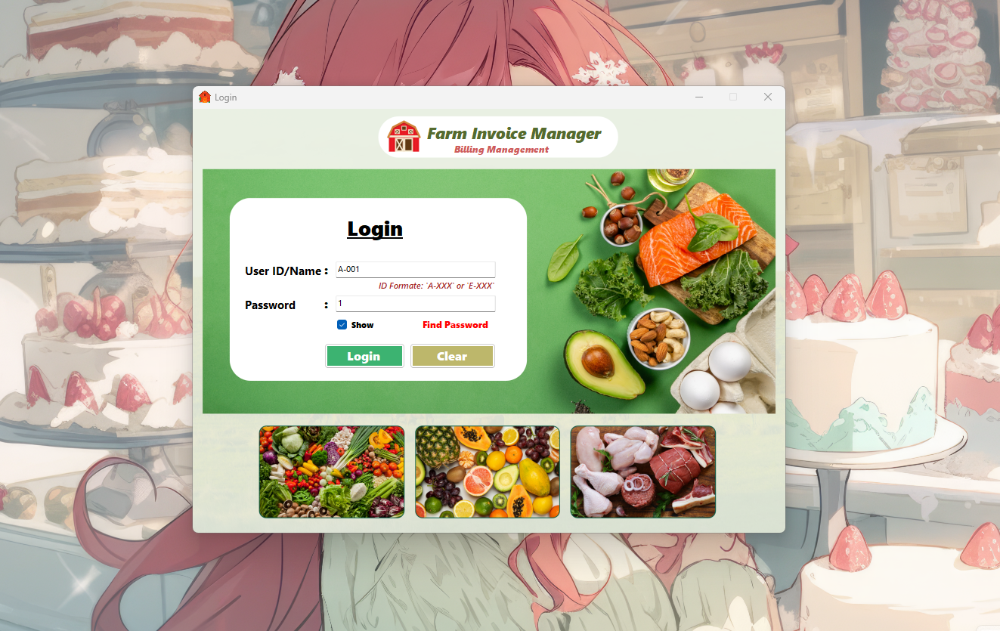
</p>

### 2. Find Password

Shows a forgotten password when the User ID, username and mobile number match.

<p align="center">
  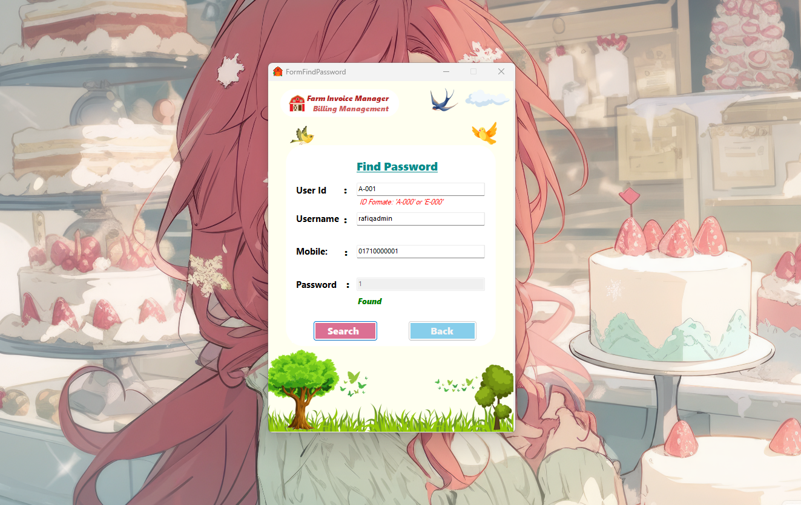
</p>

### 3. Admin Dashboard

List of all users with search, add, update and delete.

<p align="center">
  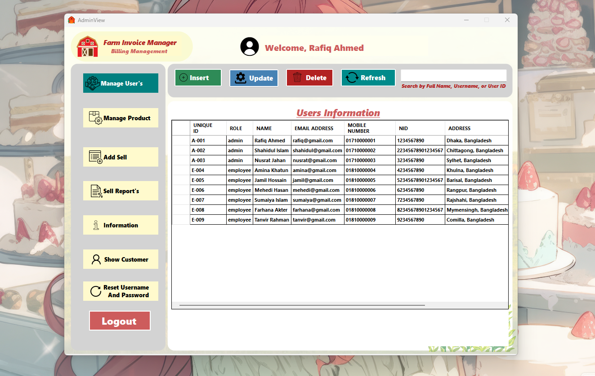
</p>

### 4. Add User

Add a new admin or employee. Every field is checked while typing.

<p align="center">
  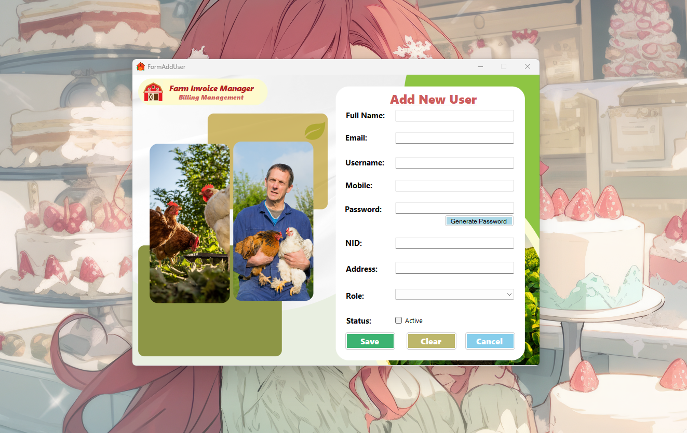
</p>

### 5. Edit Existing User

Change the information of the selected user.

<p align="center">
  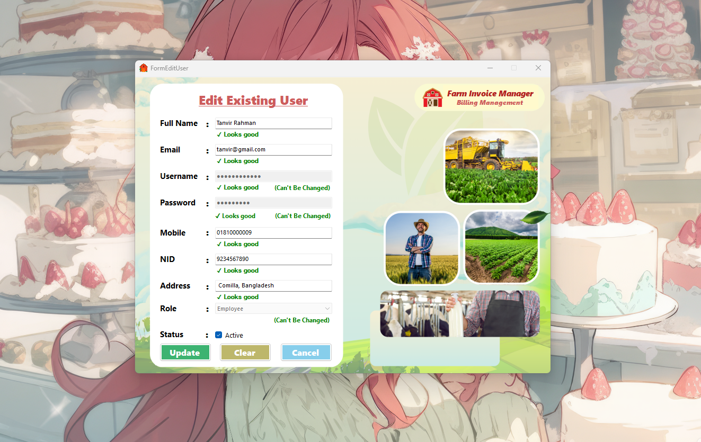
</p>

### 6. Manage Products

All products with search, add, update and delete.

<p align="center">
  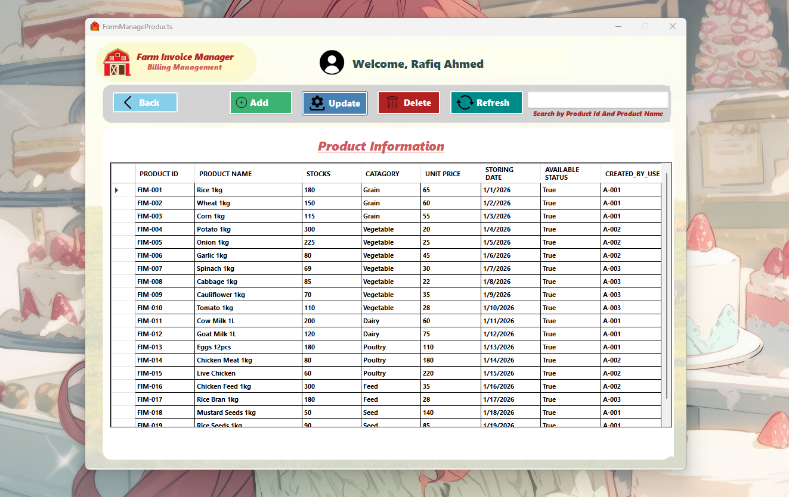
</p>

### 7. Add Product

Add a new product. The product ID (FIM-001 ...) is made automatically.

<p align="center">
  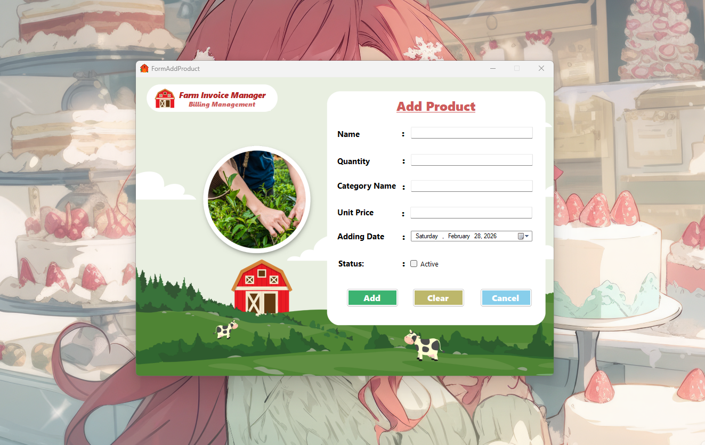
</p>

### 8. Update Product

Change the name, stock, category, price or status of a product.

<p align="center">
  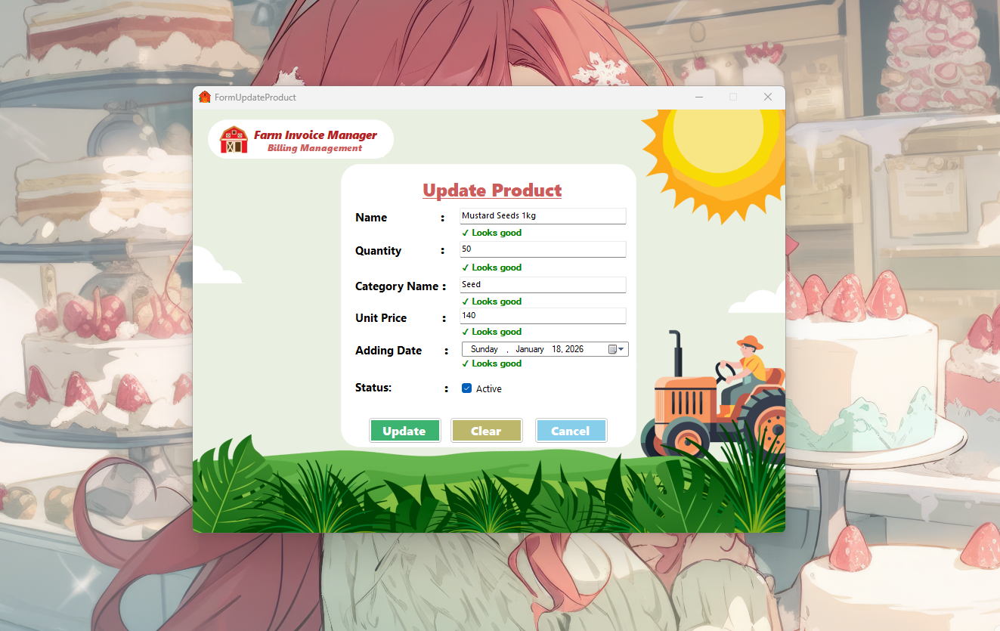
</p>

### 9. Personal Information

Information of the logged in user.

<p align="center">
  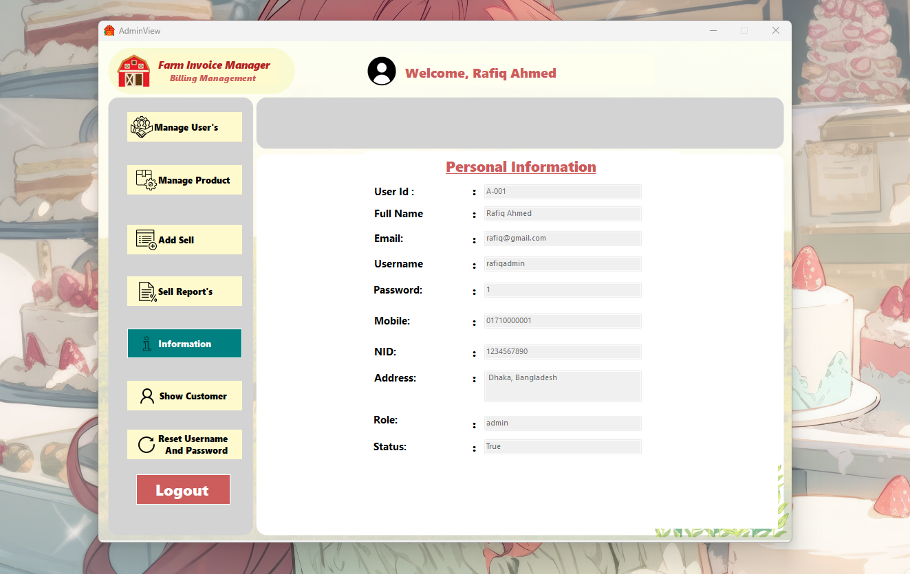
</p>

### 10. Customers

Premium customer list with search by mobile number.

<p align="center">
  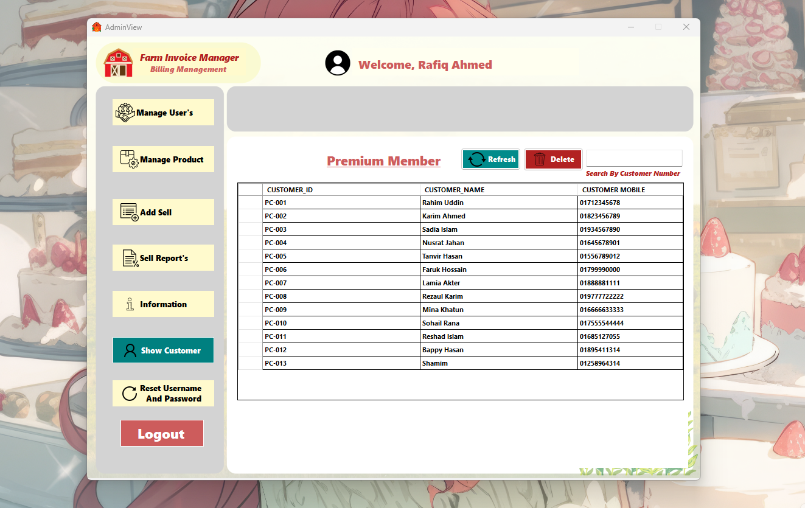
</p>

### 11. Reset Username and Password

The logged in user changes their own username and password.

<p align="center">
  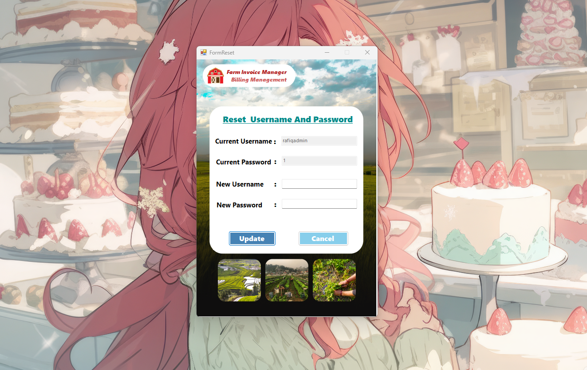
</p>

### 12. Add Premium Customer

Save a customer as a premium member from the sales page.

<p align="center">
  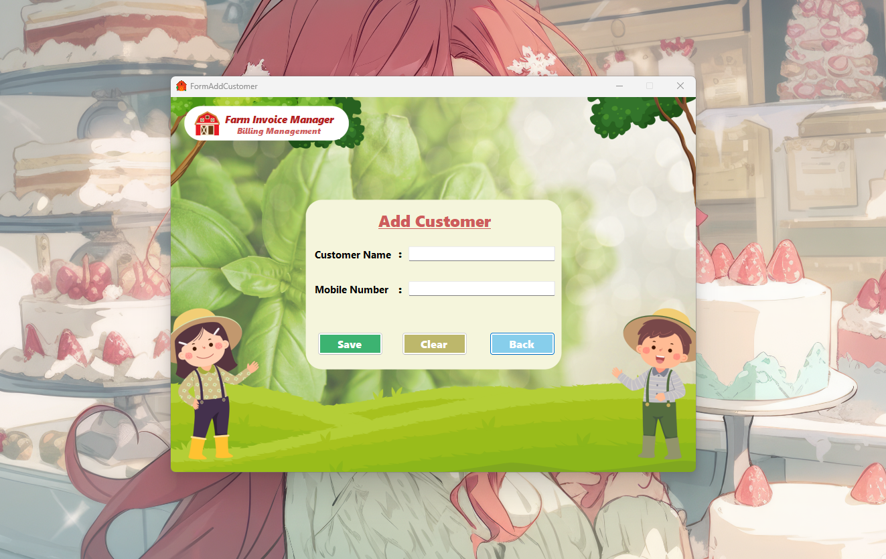
</p>

### 13. Add Sales

Choose the customer, add products to the cart, give a discount and save the invoice.

<p align="center">
  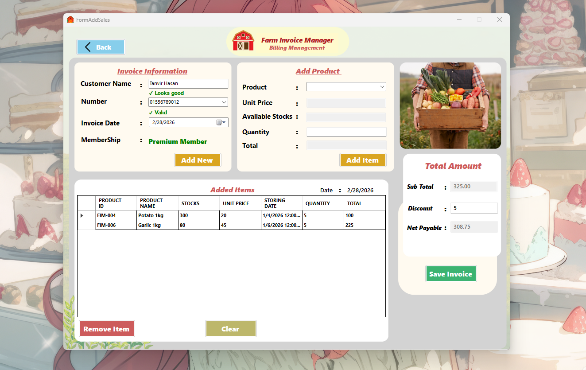
</p>

### 14. Invoice

The saved invoice, ready to print.

<p align="center">
  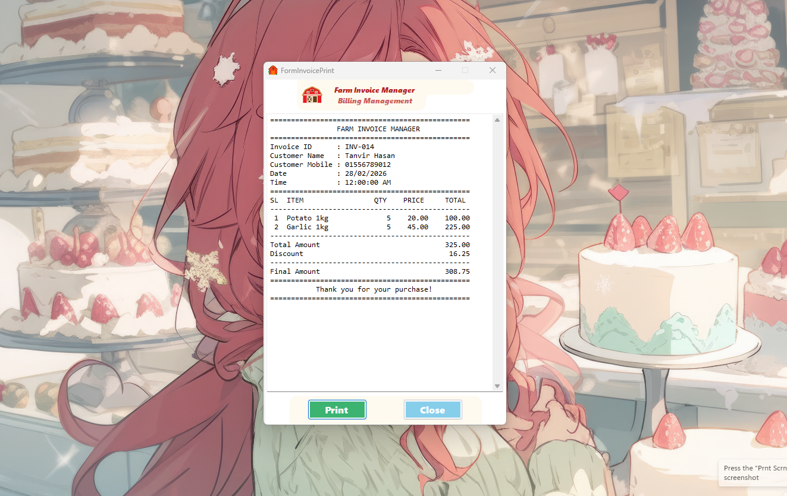
</p>

### 15. Sales Report

All invoices with total sales, average sale, a chart and search by date or mobile number.

<p align="center">
  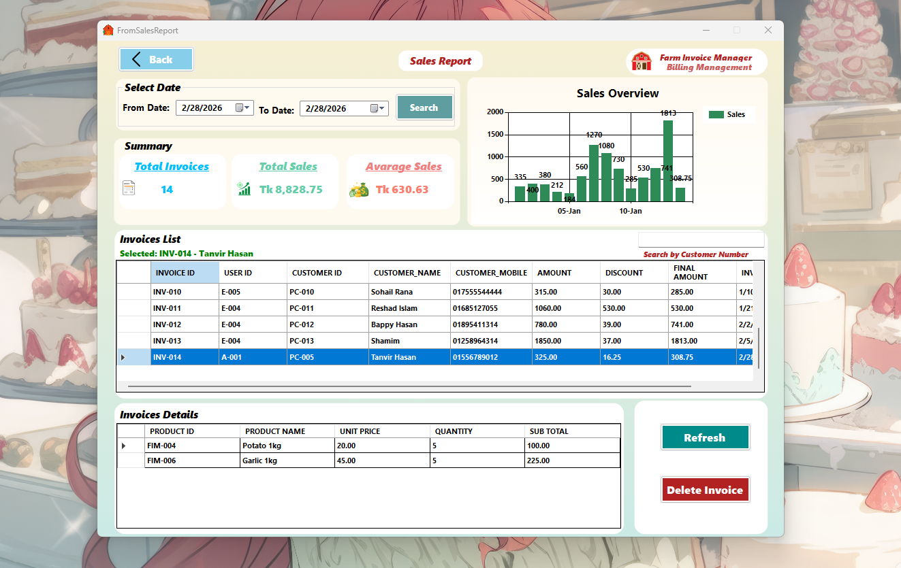
</p>

### 16. Employee Dashboard

Employees can see their information and customers, add sales and see the sales report.

<p align="center">
  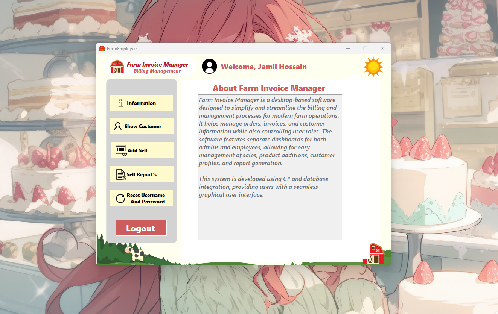
</p>
