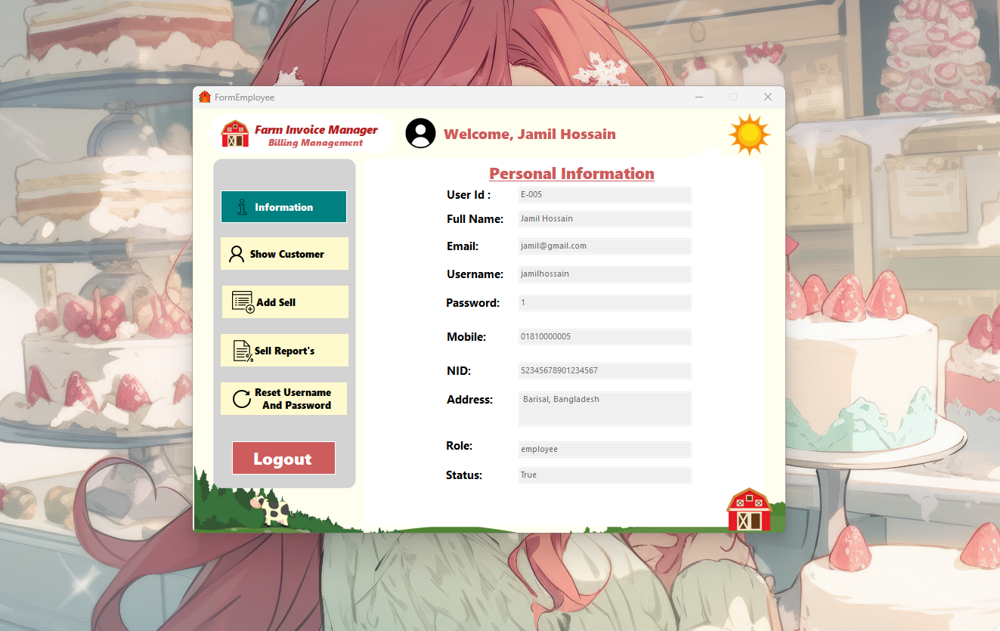
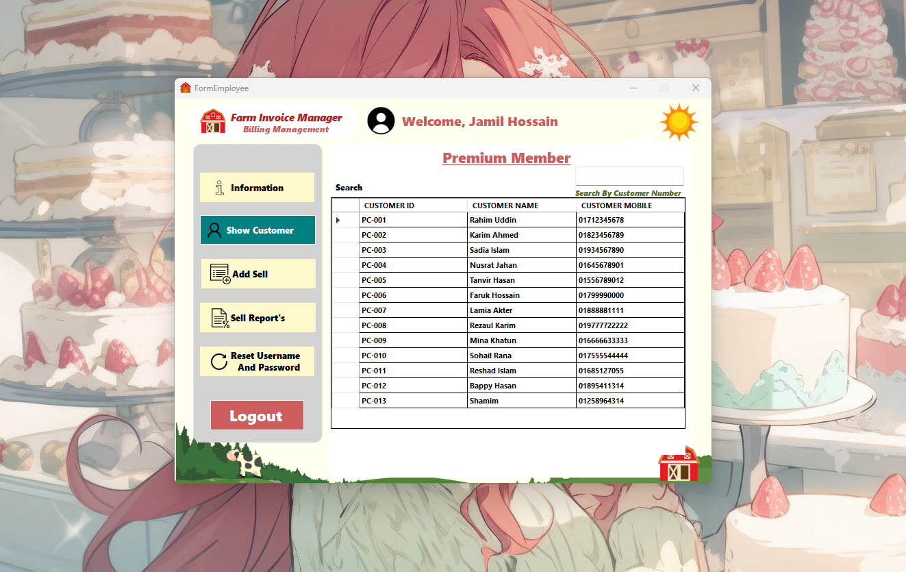

# FarmInvoiceManager

This is a C# project for managing farm invoices. It is integrated with Microsoft SQL Server for data management.

## Features

- Create, manage, and track farm invoices.
- Manage customer and product data.
- SQL database integration for storing all records.

## Setup Instructions

- Clone the repository to your local machine.
- Open the solution in Visual Studio.
- Set up the SQL Server database using the provided SQL script.
- Configure the connection string in the app configuration.
- Build and run the application.

## Usage

Once configured, you can use the system to generate invoices, manage customers, and maintain farm product information.
## Farm Invoice Manager - User Interface Screenshots

1. **Login Page**  
   

2. **Find Password**  
   

3. **Dashboard**  
   

4. **Add User**  
   

5. **Edit Existing User**  
   

6. **Manage Product**  
   

7. **Add Product**  
   

8. **Update Product**  
   

9. **Personal Information (Employee View)**  
   

10. **Show Customer**  
    

11. **Reset Username and Password**  
    

12. **Add Premium Customer**  
    

13. **Add Sales**  
    

14. **Invoice**  
    

15. **Sales Report**  
    

16. **Employee Dashboard**  
    

17. **Personal Information (Employee View)**  
    

18. **Employee Show Customer**  
    
## How to Use
1. Clone the repository to your local machine:
   ```bash
   git clone https://github.com/munshi-rishad/CSharp-FarmInvoiceManager-Repository.git
